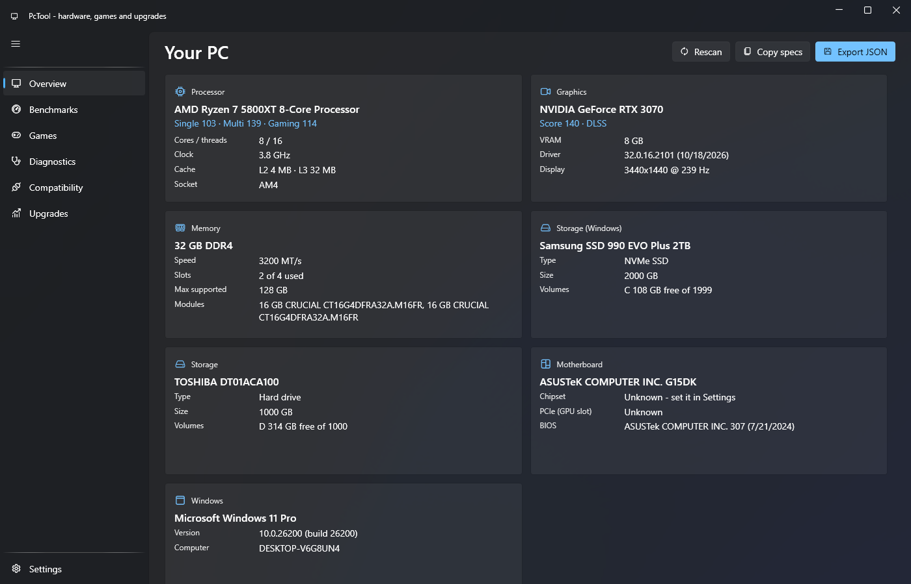
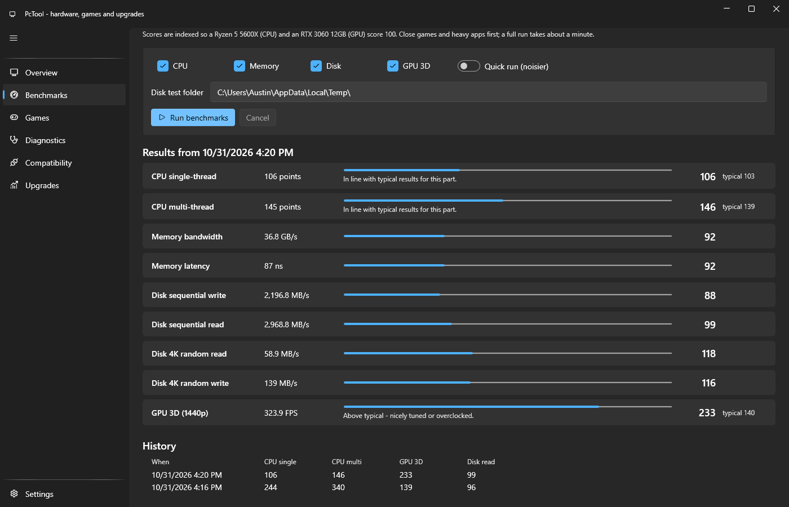
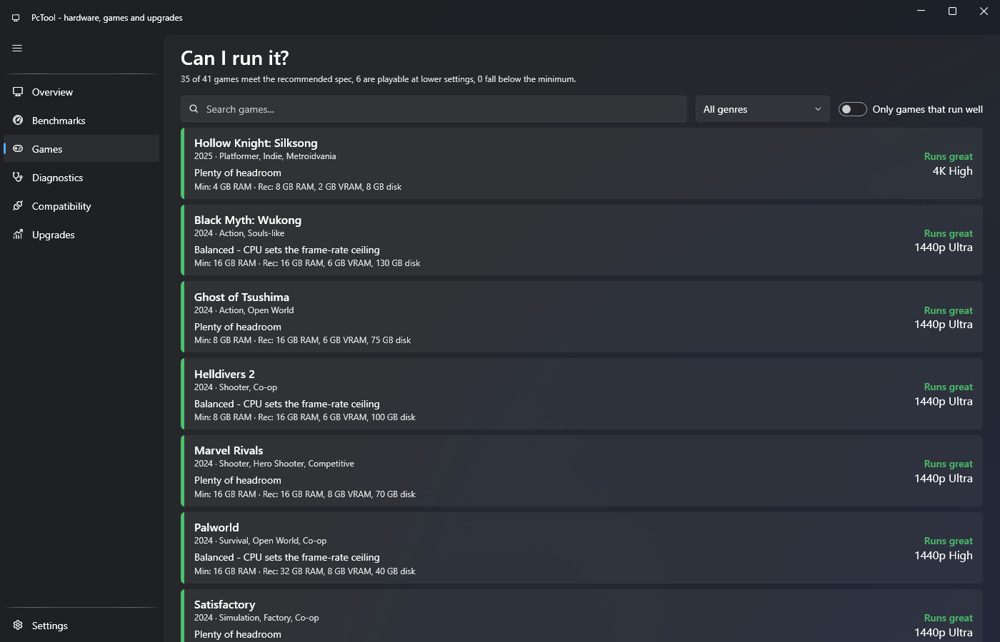
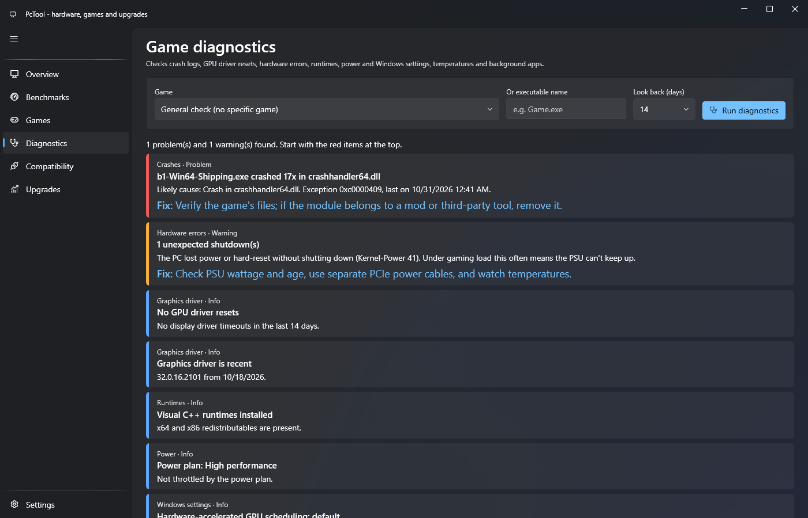
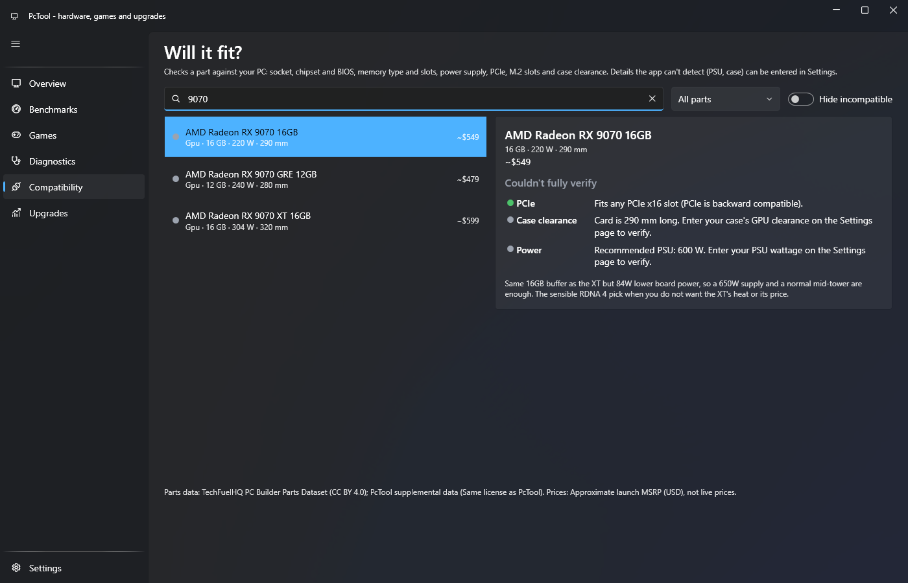
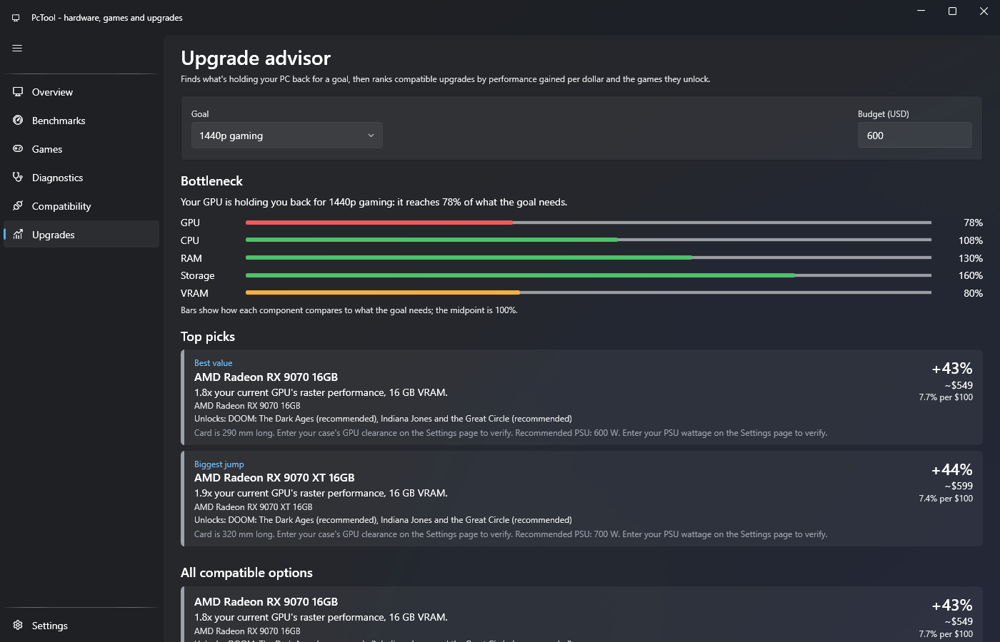
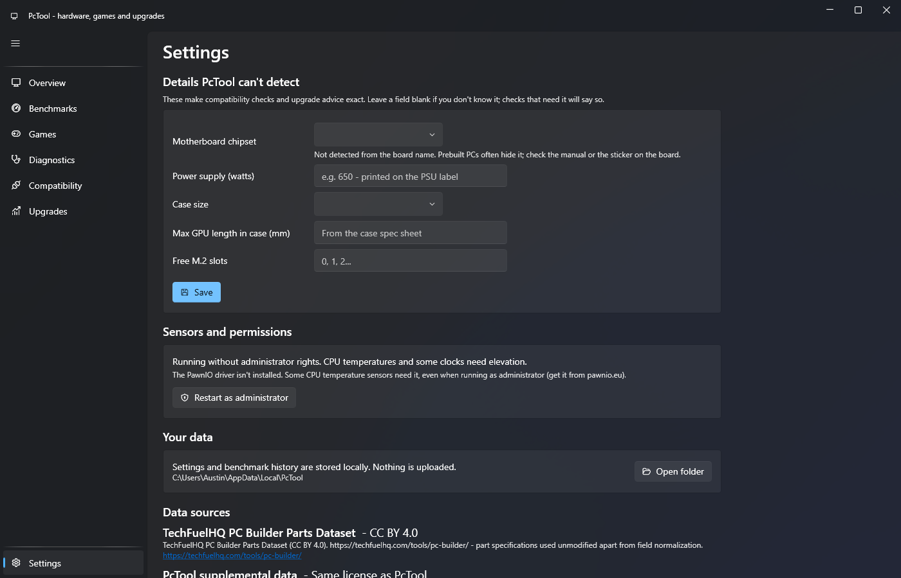

# PcTool

A Windows desktop app that profiles your PC, benchmarks it, tells you which games it runs well, diagnoses game problems, checks whether a new part is compatible, and recommends upgrades ranked by performance per dollar.

Built with .NET 8, WPF and [WPF-UI](https://github.com/lepoco/wpfui).

## Features

| Page | What it does |
|---|---|
| Overview | CPU, GPU, memory, storage, motherboard and Windows details, live sensors, JSON export |
| Benchmarks | CPU single/multi-thread, memory bandwidth/latency, disk sequential/4K, Direct3D 11 GPU test; history saved locally |
| Games | "Can I run it?" verdicts for ~40 popular games with a suggested preset and the bottleneck |
| Diagnostics | Crash and hang events, GPU driver resets (TDR), WHEA hardware errors, VC++ runtimes, driver age, power plan, Game Mode/HAGS, page file, disk space, temperatures, overlay apps |
| Compatibility | Checks any part in the catalog against your PC: socket, chipset/BIOS, RAM type and slots, PSU headroom, PCIe, M.2, case clearance |
| Upgrades | Finds the bottleneck for a goal (1080p/1440p/4K, a specific game, productivity) and ranks compatible upgrades and platform bundles within a budget |
| Settings | Details the app can't detect (chipset on prebuilts, PSU, case), restart as administrator, data sources and licenses |

Scores are indexed so a **Ryzen 5 5600X = 100** (CPU) and an **RTX 3060 12GB = 100** (GPU).

## Screenshots



<details>
<summary>More screenshots</summary>

### Benchmarks


### Games


### Diagnostics


### Compatibility


### Upgrades


### Settings


</details>

To refresh them, build in Release and run `tools/capture-screenshots.ps1 -RunBenchmark`. The app accepts `--page <Name>` (for example `--page Games`) to open on a specific page.

## Requirements

- Windows 10 or 11, x64
- [.NET 8 SDK](https://dotnet.microsoft.com/download/dotnet/8.0) to build

CPU temperatures and some clocks need the app to run as administrator (Settings > Restart as administrator); some CPUs also need the [PawnIO](https://pawnio.eu) driver.

## Build and run

```powershell
dotnet build PcTool.sln
dotnet run --project src/PcTool.App
dotnet test tests/PcTool.Logic.Tests
```

Self-contained single-file release build (output in `artifacts/publish/win-x64/`):

```powershell
dotnet publish src/PcTool.App -p:PublishProfile=win-x64
```

### Developer CLI

`tools/PcTool.Cli` runs every engine without the UI, which is handy when editing data:

```powershell
dotnet run --project tools/PcTool.Cli -- profile
dotnet run --project tools/PcTool.Cli -- bench --quick
dotnet run --project tools/PcTool.Cli -- games
dotnet run --project tools/PcTool.Cli -- upgrades --goal Gaming1440p --budget 600
dotnet run --project tools/PcTool.Cli -- check --part "RTX 5070" --psu 650 --gpu-len 320
dotnet run --project tools/PcTool.Cli -- diag --game cyberpunk-2077
```

Override undetectable details with `--chipset B550 --psu 750 --case ATX --gpu-len 330 --m2 1`.

## Project layout

```
src/
  PcTool.Core           Models and interfaces (IGameCatalog, IPartsCatalog, IPriceSource, ...)
  PcTool.Data           Embedded data loaders, name matching, SystemSpecsBuilder
  PcTool.Hardware       WMI / DXGI / LibreHardwareMonitor detection
  PcTool.Benchmarks     CPU, memory, disk and Direct3D 11 benchmarks
  PcTool.Games          GameAdvisor ("can it run")
  PcTool.Compatibility  CompatibilityEngine rules
  PcTool.Upgrades       UpgradeAdvisor (bottleneck, candidates, ranking)
  PcTool.Diagnostics    GameDiagnostics (event logs, WER, settings, thermals)
  PcTool.App            WPF UI (pages + view models)
data/                   CSV/JSON embedded into PcTool.Data at build time
tests/PcTool.Logic.Tests
tools/PcTool.Cli
```

## Data

| File | Contents |
|---|---|
| `data/tiers/cpus.csv`, `gpus.csv` | Performance tiers and name aliases used to match detected hardware |
| `data/platforms/chipsets.csv` | Socket, memory, PCIe and BIOS-support rules per chipset |
| `data/games/games.json` | Minimum/recommended specs referencing tier ids |
| `data/parts/*.json` | Parts catalog (TechFuelHQ dataset + PcTool supplemental older-platform parts) |
| `data/prices/reference-prices.json` | Approximate USD list prices for ranking |

Recommendation data sits behind `IGameCatalog`, `IPartsCatalog` and `IPriceSource`, so a live price feed or a hosted catalog can replace the bundled files without touching the engines.

## Licenses

Parts data comes from the [TechFuelHQ PC Builder Parts Dataset](https://techfuelhq.com/tools/pc-builder/) (CC BY 4.0). Third-party libraries are MIT, Apache-2.0 and MPL-2.0 (LibreHardwareMonitor, used unmodified). See [THIRD-PARTY-NOTICES.txt](THIRD-PARTY-NOTICES.txt).
